# SpliceGAIP 部署架构对比

## 传统方式 vs Coolify 方式

```mermaid
graph TB
    subgraph Traditional["❌ 传统手动部署"]
        A1[本地开发] --> B1[SSH 登录服务器]
        B1 --> C1[手动安装 Docker]
        C1 --> D1[配置 docker-compose.yml]
        D1 --> E1[设置 Nginx 反向代理]
        E1 --> F1[申请 SSL 证书]
        F1 --> G1[手动启动容器]
        G1 --> H1[验证部署]
        H1 -->|每次更新| I1[重复以上步骤 ]
    end

    subgraph Coolify["✅ Coolify 一键部署"]
        A2[本地开发] --> B2[git push]
        B2 --> C2[Coolify 自动检测]
        C2 --> D2[自动构建镜像]
        D2 --> E2[自动部署容器]
        E2 --> F2[自动配置 SSL]
        F2 --> G2[健康检查通过]
        G2 --> H2[部署完成 🎉]
        H2 -->|下次更新| B2
    end

    style Traditional fill:#ffebee,stroke:#c62828
    style Coolify fill:#e8f5e9,stroke:#2e7d32
```



---

## 时间对比

| 任务 | 传统方式 | Coolify 方式 | 节省时间 |
|------|---------|-------------|---------|
| 首次部署 | 2-4 小时 | 15 分钟 | **90%** ⚡ |
| 代码更新 | 30 分钟 | 自动（0 分钟） | **100%** ⚡ |
| SSL 配置 | 1 小时 | 自动 | **100%** ⚡ |
| 监控设置 | 2 小时 | 内置 | **100%** ⚡ |
| 日志查看 | SSH + docker logs | Web UI | **体验提升** ✨ |
| 回滚版本 | 手动操作 | 一键回滚 | **体验提升**  |

---

## 功能对比

### 传统方式

```bash
# 你需要记住的命令
ssh user@server
sudo apt update && sudo apt install docker.io docker-compose
vim docker-compose.yml
docker compose up -d --build
sudo apt install nginx
vim /etc/nginx/sites-available/splicegaip
sudo certbot --nginx -d splicegaip.your-domain.com
docker logs -f splicegaip-api
# ... 还有更多 😓
```

### Coolify 方式

```bash
# 你只需要做的
git push origin main
# 然后喝杯咖啡 ☕，一切自动完成！
```

---

## 管理界面对比

### 传统方式：命令行

```
❌ 没有可视化界面
❌ 需要记忆大量命令
❌ 日志分散在各个文件
❌ 资源使用率需要手动查询
❌ 多项目管理困难
```

### Coolify 方式：Web 控制台

```
✅ 直观的仪表盘
✅ 实时日志流
✅ CPU/内存/磁盘图表
✅ 一键重启/停止/删除
✅ 多项目统一管理
✅ 团队协作支持
```

---

## 成本分析

### 传统方式

| 项目 | 成本 |
|------|------|
| 服务器 | ¥100-300/月 |
| 运维时间 | 5-10 小时/月 |
| 学习成本 | 高（Docker/Nginx/Linux） |
| 故障恢复 | 慢（需手动排查） |
| **总成本** | **¥100-300 + 大量时间** |

### Coolify 方式

| 项目 | 成本 |
|------|------|
| 服务器 | ¥100-300/月（相同） |
| Coolify | **免费**（开源） |
| 运维时间 | 0.5 小时/月 |
| 学习成本 | 低（Web UI 操作） |
| 故障恢复 | 快（自动监控+告警） |
| **总成本** | **¥100-300 + 极少时间** |

**节省**: 每月节省 5-10 小时运维时间 = **每年节省 60-120 小时** ⏰

---

## 适用场景

### ✅ 推荐使用 Coolify

- 个人开发者/小团队
- 有多个项目需要管理
- 不想花时间运维基础设施
- 需要快速迭代和部署
- 希望有专业的监控和日志

### ❌ 不推荐 Coolify

- 已有成熟的 K8s 集群
- 需要极致的性能优化
- 有特殊的安全合规要求
- 团队已有完整的 DevOps 流程

---

## 迁移路径

如果你已经在用传统方式部署，迁移到 Coolify 很简单：

```bash
# 1. 在服务器上安装 Coolify
curl -fsSL https://cdn.coollabs.io/coolify/install.sh | bash

# 2. 在 Coolify 中导入现有项目
# Projects → Add Project → Import Existing Container

# 3. 验证一切正常后，停止旧的手动部署
docker stop old-splicegaip-container

# 4. 享受自动化部署！🎉
```

---

## 总结

> **Coolify = 在你的服务器上搭建一个私有的 Vercel/Coze**

**核心价值**：
- ⚡ **速度**: 从小时级部署缩短到分钟级
- 🎯 **简单**: Web UI 替代复杂命令行
-  **自主**: 数据完全掌控在自己的服务器
- 💰 **免费**: 开源软件，无订阅费用
- 📊 **专业**: 企业级监控和管理功能

**适合 SpliceGAIP 的原因**：
1. 科研团队通常没有专职运维
2. 需要频繁更新分析算法
3. 多个实验室可能共享服务器
4. 需要可靠的日志用于审计

---

**开始使用**: 阅读 [DEPLOY_COOLIFY.md](DEPLOY_COOLIFY.md) 获取详细步骤
